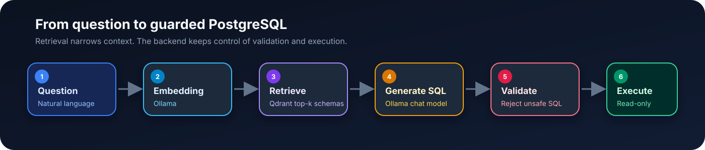
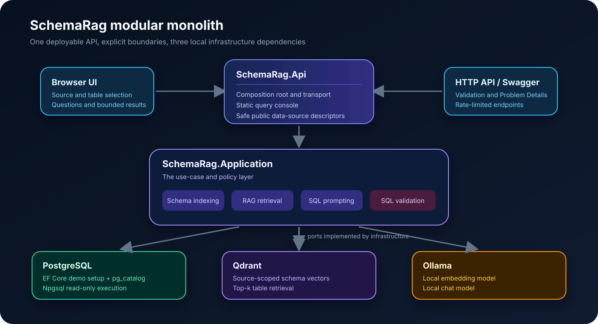

# SchemaRag

[](https://dotnet.microsoft.com/)
[](https://www.postgresql.org/)
[](https://docs.docker.com/compose/)
[](LICENSE)

A focused natural-language-to-SQL reference implementation built with .NET 10,
PostgreSQL, Qdrant, and Ollama.

SchemaRag discovers a PostgreSQL schema, retrieves the most relevant tables for
a question, asks a local LLM to generate PostgreSQL, validates the generated
statement, and executes it through a read-only connection.



## What this project demonstrates

- A modular-monolith .NET backend with clear dependency boundaries.
- Live PostgreSQL metadata discovery through `pg_catalog`.
- Source- and table-scoped schema retrieval from Qdrant.
- Local chat and embedding models through Ollama.
- Conservative SQL validation and a `ValidatedSql` execution boundary.
- Read-only PostgreSQL execution with timeouts and a hard row limit.
- A dependency-free browser UI, Swagger, deterministic seed data, and xUnit tests.
- Server-configured external PostgreSQL profiles without accepting credentials
  from the browser.

The repository intentionally avoids microservices, agents, MCP, cloud services,
and frontend build tooling.

## Why RAG?

Sending hundreds of table definitions to an LLM makes prompts larger, slower,
and noisier. It also increases the chance of choosing an unrelated table or
inventing a column.

SchemaRag creates one document per table. Each document includes:

- schema and table name;
- table and column descriptions;
- PostgreSQL types and nullability;
- primary keys; and
- foreign-key relationships.

For each question, Qdrant retrieves only the most relevant three to five schema
documents. Qdrant does **not** generate SQL: it only selects context. Ollama still
maps the user's intent to projections, joins, filters, grouping, and ordering.

## Architecture



The request path is deliberately linear:

1. Discover live table metadata from a configured PostgreSQL source.
2. Embed and index the selected schema documents in Qdrant.
3. Embed the user's question and retrieve the closest schema documents.
4. Build a prompt from the question and retrieved schema context.
5. Ask Ollama for one PostgreSQL query.
6. Validate its shape, keywords, referenced tables, and row limit.
7. Execute it in a read-only transaction and return bounded results.

Project responsibilities:

| Project | Responsibility |
|---|---|
| `SchemaRag.Domain` | Demo entities and immutable schema records |
| `SchemaRag.Application` | Indexing, prompting, orchestration, validation, ports |
| `SchemaRag.Infrastructure` | PostgreSQL, EF Core, Npgsql, Qdrant, Ollama adapters |
| `SchemaRag.Api` | HTTP endpoints, DI, Problem Details, Swagger, UI |

## Quick start

### Requirements

- Docker with Compose
- Approximately 8 GB free memory for a comfortable local-model experience
- Optional: [.NET 10 SDK](https://dotnet.microsoft.com/download/dotnet/10.0)

### 1. Create local configuration

```bash
cp .env.example .env
```

Replace these values in `.env` with two different random passwords:

```dotenv
POSTGRES_ADMIN_PASSWORD=replace-with-a-strong-admin-password
APP_READONLY_PASSWORD=replace-with-a-different-readonly-password
```

`.env` and the local Docker data directory are ignored by Git.

### 2. Start PostgreSQL, Qdrant, and Ollama

```bash
docker compose up -d postgres qdrant ollama
```

### 3. Download the local models

```bash
docker compose exec ollama ollama pull nomic-embed-text
docker compose exec ollama ollama pull qwen2.5-coder:7b
```

### 4. Start the API

```bash
docker compose up -d --build api
docker compose ps
curl http://localhost:8080/health
```

Open:

- Query UI: <http://localhost:8080/>
- Swagger: <http://localhost:8080/swagger>

In the UI, select a data source, choose the tables, click **Index selected
tables**, and ask a question.

Example questions:

```text
Show the top 5 customers by total order amount.
What were the monthly sales totals?
Which products have the lowest stock?
```

## API examples

Index all five tables in the built-in demo source:

```bash
curl -X POST http://localhost:8080/api/schema/index
```

Ask a question:

```bash
curl -X POST http://localhost:8080/api/query \
  -H 'Content-Type: application/json' \
  -d '{
    "question": "Show the top 5 customers by total order amount."
  }'
```

Representative response—the exact SQL can vary by model:

```json
{
  "dataSourceId": "demo",
  "question": "Show the top 5 customers by total order amount.",
  "retrievedTables": [
    "public.customers",
    "public.orders",
    "public.order_items"
  ],
  "generatedSql": "SELECT ... LIMIT 5",
  "columns": ["customer_name", "total_amount"],
  "rows": [],
  "executionTimeMs": 20
}
```

Useful endpoints:

| Method | Route | Purpose |
|---|---|---|
| `GET` | `/health` | Process health |
| `GET` | `/api/data-sources` | List configured sources without credentials |
| `GET` | `/api/data-sources/{id}/schema` | Discover live PostgreSQL metadata |
| `POST` | `/api/data-sources/{id}/schema/index` | Index selected table IDs |
| `POST` | `/api/query` | Retrieve schemas, generate, validate, and execute SQL |
| `GET` | `/api/schema` | Discover the default demo source |
| `POST` | `/api/schema/index` | Index every table in the demo source |

## Use your own PostgreSQL database

External databases are registered as trusted server-side profiles. The UI lists
the configured profiles, but it never receives or accepts a connection string.

```bash
cp compose.external-db.example.yaml compose.external-db.yaml
```

Set `EXTERNAL_DB_DISPLAY_NAME`, `EXTERNAL_DB_CONNECTION_STRING`, and
`EXTERNAL_DB_SCHEMA` in the ignored `.env`, then start with both Compose files:

```bash
docker compose \
  -f compose.yaml \
  -f compose.external-db.yaml \
  up -d --build api
```

The external role must have only `CONNECT`, schema `USAGE`, and table `SELECT`
permissions, with `default_transaction_read_only=on`.

See [Connecting an external PostgreSQL database](docs/external-postgresql.md)
for the complete setup and least-privilege SQL.

## Security model

> [!WARNING]
> This is a local demonstration without authentication. Keep it on loopback or
> a tightly controlled private network. Do not expose it directly to the internet.

Generated SQL is always untrusted. SchemaRag uses several independent controls:

- data-source credentials exist only in server configuration;
- Qdrant retrieval is scoped by source and selected table IDs;
- retrieved metadata is rehydrated from the live catalog and version-checked;
- the prompt requests one PostgreSQL `SELECT`/read-only CTE and a bounded limit;
- validation rejects comments, multiple statements, writes, DDL, permission
  changes, system schemas, dangerous functions, row locks, and unknown tables;
- only `ValidatedSql` reaches the executor;
- execution uses a verified read-only role and transaction, a statement timeout,
  cancellation, and a maximum returned row count; and
- connection strings, prompts, SQL text, and result rows are not logged.

The validator is a conservative lexical scanner with a table allow-list. It is
**not a production-grade PostgreSQL AST parser**. A production system should also
use curated views or a reporting replica, AST policy enforcement, authentication,
per-source authorization, TLS, audit events, and query-cost checks.

For vulnerability reporting and the public-release checklist, see
[SECURITY.md](SECURITY.md).

## Configuration

Important `.env` settings:

| Variable | Default | Description |
|---|---:|---|
| `API_PORT` | `8080` | Published API port |
| `API_BIND_ADDRESS` | `127.0.0.1` | Published host interface |
| `SCHEMA_RETRIEVAL_COUNT` | `4` | Retrieved schemas; allowed range 3–5 |
| `MAX_TABLES_PER_INDEX` | `100` | Maximum tables in one index request |
| `QUERY_TIMEOUT_SECONDS` | `5` | Database statement timeout |
| `QUERY_MAX_ROWS` | `100` | SQL and response row cap |
| `OLLAMA_CHAT_MODEL` | `qwen2.5-coder:7b` | SQL-generation model |
| `OLLAMA_EMBEDDING_MODEL` | `nomic-embed-text` | Embedding model |
| `OLLAMA_EMBEDDING_DIMENSIONS` | `768` | Qdrant vector dimension |
| `QDRANT_COLLECTION_NAME` | `schema_documents` | Schema collection |

If the embedding model or dimensions change, recreate the Qdrant collection and
reindex the selected schemas.

## Development

```bash
dotnet tool restore
dotnet restore SchemaRag.slnx
dotnet format SchemaRag.slnx --verify-no-changes --no-restore
dotnet build SchemaRag.slnx --no-restore
dotnet test SchemaRag.slnx --no-build --no-restore
```

CI also enforces 80% line coverage for `SchemaRag.Application` and validates the
Compose configuration. Dependabot tracks NuGet, Docker, and GitHub Actions.

## Project structure

```text
.
├── .github/                  # CI and Dependabot
├── docs/                     # Public diagrams and external DB guide
├── docker/postgres/          # Demo read-only role initialization
├── src/
│   ├── SchemaRag.Api/        # HTTP API, Swagger, browser UI
│   ├── SchemaRag.Application/ # Use cases and security boundaries
│   ├── SchemaRag.Domain/     # Entities and schema records
│   └── SchemaRag.Infrastructure/
├── tests/SchemaRag.Tests/
├── compose.yaml
└── SchemaRag.slnx
```

## Known limitations

- SQL quality depends on the selected model and schema descriptions.
- Only PostgreSQL tables and partitioned tables are discovered; views and
  functions are not supported.
- Reindexing replaces the selected source's existing Qdrant documents.
- Schema changes require manual reindexing.
- There is no authentication, audit store, query-cost estimation, sensitive
  column policy, metadata cache, or automatic model evaluation.
- Health reporting is process liveness, not dependency readiness.
- Docker Compose is for local demonstration, not production deployment.

## Key design decisions

- RAG narrows a large schema; it does not generate SQL.
- The LLM handles semantic translation, while the backend owns policy and access.
- Source identity flows through discovery, indexing, retrieval, validation, and
  execution to prevent cross-database confusion.
- EF Core owns deterministic demo setup; Npgsql handles dynamic metadata and
  generated result sets.
- Prompt constraints, SQL validation, executor limits, and PostgreSQL permissions
  are independent controls—none is trusted alone.
- A modular monolith keeps the security-sensitive workflow easy to inspect and
  debug.

## License

[MIT](LICENSE)
